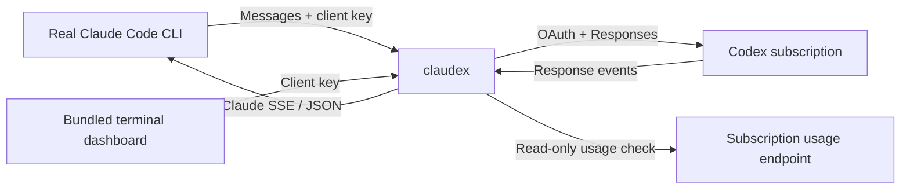

# How claudex works

claudex translates Claude Code's Messages API traffic for a single Codex
subscription account. It has no provider plugins, model downloads, generic OpenAI
endpoints, or account load balancing.

## Request lifecycle

1. The launcher starts or reuses a compatible gateway and injects its client key
   and active preferences into Claude Code. The Codex credential stays with the gateway.
2. The gateway authenticates and bounds the request, resolves the model, and
   translates Messages input into Responses input.
3. The credential store refreshes expiring credentials with a cross-process lock
   and atomic persistence. A still-valid access token survives a transient refresh
   failure. After HTTP 401, it refreshes and resends once, unless the account changed.
4. The transport sends to the fixed Codex subscription endpoint. Recognized transport
   failures can retry once before message delivery; see [recovery](running.md#upstream-recovery).
   Local token estimation runs concurrently with streamed inference.
5. Translation preserves tools, images, refusals, citations, and encrypted reasoning
   continuity. Terminal failures never become empty successful turns.
6. Supported Auto Mode safeguards hold the response until complete tool verdicts
   arrive. Review errors release no tools; see [Auto Mode](auto-mode.md).
7. Generation and review metrics are recorded separately and linked by trace.
   See [TUI metrics](tui.md#what-is-measured) for accounting and retention.

## HTTP routes

These routes require the client key. Send it as `Authorization: Bearer <key>` or
as `X-Api-Key`. The `Bearer` scheme matches in any letter case. Each header is
checked on its own.

| Route | Purpose |
| --- | --- |
| `POST /v1/messages` | Messages, streamed or not |
| `POST /v1/messages/count_tokens` | Local token estimate |
| `GET /v1/models` | Model list |
| `GET /v1/models/{id}` | One model |
| `GET /_claudex/metrics` | Bounded metrics snapshot |
| `GET /_claudex/status` | Authenticated gateway state for `claudex ctl` |
| `POST /_claudex/sessions` | Attach a Claude or TUI lifetime connection |
| `GET /_claudex/config` | Preferences, startup fields, and revision |
| `PUT /_claudex/config` | Revision-checked live preferences |
| `POST /_claudex/feedback` | Store a local report when enabled |
| `GET /_claudex/feedback` | Paginated local reports |

These routes need no key:

| Route | Purpose |
| --- | --- |
| `GET /healthz` | Liveness probe for Docker and `claudex ctl` |
| `HEAD /api/hello` | Connectivity probe for Claude Code |

`GET /healthz` returns `product`, `status`, `version`, and the default `model`.
`GET /_claudex/status` identifies the control API, process instance, lifetime mode,
attached clients, active requests, revision, and active preferences. The launcher
reuses authenticated compatible gateways and uses their active defaults.

`POST /_claudex/sessions` opens an authenticated NDJSON connection with kind
`claude` or `tui`. Disconnecting releases ownership. Only automatic gateways exit
when they have no attached clients or active requests for five seconds.

`GET /_claudex/config` returns preferences, startup paths, revision and writability.
`PUT /_claudex/config` accepts only live preference fields and requires `If-Match`
with the quoted revision, scoped to this process instance and configuration.
Conflicts and drafts from before a restart return 412. Saves validate, persist atomically,
and then publish an immutable configuration snapshot. In-flight requests, including
permission reviews, keep their admitted snapshot. Startup fields require a restart.

## Reasoning and tools

claudex picks one GPT effort per request. It applies these rules in order:

| Claude request | Effort sent to GPT |
| --- | --- |
| `thinking.type: disabled` | `none` where supported; Astra and GPT-6.1 Sol get `low`. |
| Explicit `output_config.effort` | That effort, after the rewrites below |
| `thinking.type: enabled` with `budget_tokens: -1` | Configured default |
| `budget_tokens: 0` | `none` where supported, otherwise `low` |
| `budget_tokens` up to 1024 | `low` |
| `budget_tokens` up to 8192 | `medium` |
| `budget_tokens` up to 24576 | `high` |
| Larger `budget_tokens` | `xhigh` |
| No effort and no budget | Configured default |

claudex then rewrites a few values:

| Effort | Becomes |
| --- | --- |
| `auto` or empty | Configured default |
| `ultra`, `ultracode` | `xhigh` for Astra/6.1 Sol; `max` for the other catalog models |
| `minimal` | `low` |
| `max` | `max` |

An effort the model does not support returns an error. A `budget_tokens` value
that is not an integer of at least -1 also returns an error. The Codex API accepts
only `none`, `minimal`, `low`, `medium`, `high`, `xhigh`, and `max`. It rejects
`ultra`.

`ultra` selects the catalog's model-specific effort. Claude Code owns its
ultracode orchestration; claudex does not implement Codex's multi-agent harness.

Astra/6.1 Sol's `low` fallback for disabled thinking cannot promise zero reasoning.
`thinking.display: omitted` hides visible summaries but keeps encrypted reasoning
for replay. Disabled thinking also hides visible summaries.

Claude's WebSearch function and typed web-search declarations become Codex native
`web_search`. The search-grounded answer returns as text, and URL annotations
return as Markdown links. claudex does not synthesize Anthropic `server_tool_use`
or `web_search_tool_result` blocks. Those blocks cannot be resumed without
`encrypted_content` issued by Anthropic. WebFetch and ordinary local tools still run
in Claude Code. Artifact publishing is blocked because no subscription bridge for
it exists. Creating ordinary files still works.

## Response formatting

Claude Code renders ordinary Markdown. GPT can also return source-reference
markers that require its provider's renderer, such as
`citeturn0view0`. claudex translates those markers using the URL annotations
returned with the response.

- A positioned source becomes an inline Markdown link beside its claim. Multiple
  sources in one marker remain together, even when their annotations arrive in
  separate streaming events.
- Native Markdown links remain unchanged. Repeated annotation and completion
  events do not duplicate their links or the answer text.
- Sources without usable positions appear in a separate **Sources** list. Source
  titles and link targets are escaped for Markdown, and only HTTP(S) annotations
  become links.
- A reference without usable source metadata becomes `[source unavailable]`.
  Internal reference IDs are never used to guess URLs.
- Literal markers inside fenced code or inline code remain code examples.

Streaming text before a citation is delivered normally. A partial citation and
following text wait until its source annotations arrive or the content part ends,
so internal IDs do not flash on screen. Complete JSON responses use the same
conversion. Plain text, tool arguments, and encrypted reasoning replay state are
otherwise preserved.

The [OpenAI web-search documentation](https://developers.openai.com/api/docs/guides/tools-web-search)
describes URL annotations with source URLs, titles, and citation locations.
claudex renders those as Markdown rather than inventing Anthropic-issued
encrypted citation indexes or search-result credentials.

## Prompt caching

Generation and optional command reviews use separate stable cache identities.
The upstream service decides reuse. See [Prompt caching](prompt-caching.md) for
request ordering, diagnostics, and boundaries.

## Quota recovery

A subscription `usage_limit_reached` response records an in-memory cooldown. While
the cooldown lasts, a background worker checks a read-only usage endpoint once a
minute. The cooldown clears only when every returned inference pool explicitly
allows requests. Missing fields, failed probes, and stale results cannot clear a
newer failure. Short-term rate errors do not create a credential-wide cooldown.

This repairs stale local cooldowns without spending inference quota. It cannot
bypass an exhausted subscription, and it offers no account or model failover.

## Code layout

| Package | Responsibility |
| --- | --- |
| `cmd/claudex` | Flags, initialization, lifecycle, sign-in, graceful shutdown |
| `internal/config` | Strict config validation, model catalog, family aliases |
| `internal/auth` | OAuth PKCE, credential store, refresh and atomic persistence |
| `internal/codex` | Fixed upstream HTTP transport and read-only usage checks |
| `internal/proxy` | Claude HTTP surface, request policy, streaming lifecycle |
| `internal/translator/codex/claude` | Claude and Responses protocol conversion |
| `internal/quota` | Cooldown evidence, generation checks, recovery |
| `internal/tokens` | Approximate local token counting |
| `internal/metrics` | Bounded usage history and sampling |
| `internal/tui` | Terminal views, polling, and configuration editing |
| `internal/feedback` | Local MCP collector, validated bounded storage and feedback evaluation fixtures |
| `internal/control` | Shared authenticated control protocol and client |
| `internal/launcher` | Automatic worker startup, session ownership, Claude settings and bounded logs |
| `internal/signature`, `internal/translator/common` | Reasoning-signature checks and shared Claude message helpers |

## Feedback collection

When enabled in preferences, the launcher injects a stdio MCP server backed by
`claudex ctl feedback-mcp`. It calls the authenticated local control API:
`POST /_claudex/feedback` stores a validated observation and
`GET /_claudex/feedback?before=CURSOR` lists records. Settings updates and report
acceptance share a lock so disable is an immediate persistence boundary. Collection
runs independently of inference and never invokes the native Anthropic feedback
client. See [feedback](feedback.md) for provenance, retention and trust limits.
